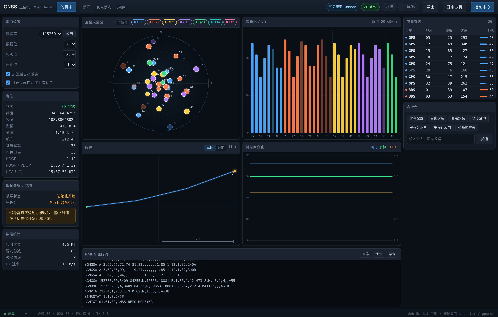

# GNSS Web Host

A browser-based GNSS receiver console. Reads the serial port directly through the Web Serial API —
no desktop app, no driver beyond the usual USB-UART one.

Sky plot, C/N0 bars, track, time series, raw NMEA stream, seven export formats,
and a log analyser that reads exported files back and explains every gap in the track.



[中文文档](README.md)

---

## Why another one

u-center, gpsmon and RTKLIB already exist and do more. This one bets on three things:

| | u-center | gpsmon | RTKLIB | This |
|---|---|---|---|---|
| Install | Windows client | terminal | desktop suite | open a browser |
| Devices | u-blox only | generic NMEA | generic / RINEX | generic NMEA + Unicore |
| Strength | full UBX | sentence decoding | post-processing | track-vs-log gap attribution |

It is not a u-center replacement. It is the tool you open **after** a drive test, when the track
has a hole in it and you need to know whether the link dropped, the fix was lost, or the vehicle
simply stopped.

---

## Quick start

```bash
git clone https://github.com/z75993971/gnss-web-host.git
cd gnss-web-host
bash start.sh          # start local server and open the browser
bash start.sh demo     # run with synthetic data, no hardware
bash stop.sh
```

Chromium-based browsers only (Edge / Chrome). Safari and Firefox do not implement Web Serial.

Press **Connect** in the top-right corner, pick your receiver. If you don't know the baud rate,
hit **Detect** — it listens at 115200 → 9600 → 38400 → 57600 → 230400 → 460800 → 921600 → 19200 → 4800
and accepts a rate only after two consecutive sentences with valid checksums.

> The serial port is exclusive. This app, u-center, and any terminal tool cannot share it.

---

## Device support

Everything except the configuration panel depends only on NMEA-0183, so **any receiver that emits
NMEA works**: u-blox, Unicore, Quectel, Trimble, and the various Chinese chipset vendors.
RMC / GGA / GSA / GSV / VTG / GST / ZDA are all parsed, with per-constellation GSA bookkeeping
(NMEA 4.11 system ID).

Configuration is split in two tiers, because that is what the hardware actually allows:

| Device | Capability | Basis |
|---|---|---|
| **Standard NMEA** (default) | read-only monitoring + generic text commands: MediaTek `$PMTK`, u-blox `$PUBX,40` | NMEA-0183 has no downstream configuration channel |
| **Unicore** (和芯星通) | output protocol, constellations, INS, aiding, timing, reset, save | `$CFG*` / `$PDTINFO`, implemented from the UFirebird protocol spec |

Detection is passive: the Unicore panel unlocks only after `$PDTINFO` or `$CFG*` is seen.
No proprietary command is ever sent to an unknown device. You can also lock the mode manually.

**No u-blox UBX binary support.** `$PUBX,40` can change sentence rates; `UBX-CFG-VALSET`,
`UBX-NAV-PVT` and friends need a dedicated binary framing channel, which this version does not have.

---

## Log analysis

Export is a one-way street: files come out, nobody reads them back. This tool reads them back.

Four classifications for a track gap, decided by looking at the log during the same interval:

| Cause | What the log shows | Severity |
|---|---|---|
| `link` | nothing at all — the log stops too | critical |
| `lost` | GGA present but `quality=0` for >80% of the gap | warning |
| `static` | fix is fine, movement is tiny | **info — not a fault** |
| `unrecorded` | fix is fine, movement is obvious | warning |

Scoring: availability 45% / continuity 25% / link integrity 20% / checksum correctness 10%.
A ≥ 92, B ≥ 80, C ≥ 65. Reports come out as HTML (editable, printable), Markdown, or an issue CSV.

Details and thresholds: [docs/analysis-engine.md](docs/analysis-engine.md) (Chinese).

Try it without hardware:

```bash
python3 tools/make_samples.py
# then open ?an=sample in the browser
```

The bundled sample is one deliberately broken session: 571 track points, 10,353 sentences,
six injected fault types. Both files → **grade A, 93.1, 11 issues**. Track only → B, 88.3, 5 issues.

---

## Export

Track: GPX / KML / GeoJSON / CSV. Log: raw NMEA / timestamped text / JSONL.

Exported coordinates are **always WGS84 raw values**. The map view applies a GCJ-02 shift for
Chinese basemaps, but files never do — shifting them breaks Google Earth, QGIS and everything else.
Note that GeoJSON uses `[lon, lat, alt]` while GPX uses `lat`/`lon` attributes.

---

## HarmonyOS collector

`harmony/` is a separate ArkTS app for the case where you have no laptop at hand:
the phone powers the module over OTG, reads the USB serial port, parses NMEA, draws the track,
and writes raw sentences into the app sandbox.

The demo pipeline has been verified on a real device (HarmonyOS 7.0 / API 26):
parsing, UI, track, file output, maps. **Real USB serial reading is still unverified** —
it needs the module plugged into the phone's USB-C port.

```bash
cd harmony
bash tools/build.sh          # requires DevEco Studio and your own signing config
```

No signing material or map key is shipped in this repo: `signingConfigs` is an empty array
and `map.html` uses an `__AMAP_KEY__` placeholder that `tools/set-map-key.sh` fills in.
Files written by the app are plain NMEA lines, so they can be dropped straight into
the log analyser above.

---

## Tests

```bash
node selftest.mjs        # 260 assertions, pure logic
```

Covers parsing edge cases, GSA/GSV handling, checksums, GCJ-02 round-trip, bitmask codecs,
all seven export formats, export→import round-trip, gap attribution, spike merging and scoring.

---

## Limits

- No RTK solving. Only the fix quality reported by the receiver is displayed.
- No UBX binary protocol.
- No data repair — the analyser reports, it does not modify your track.
- Track and log must cover the same time window, otherwise gaps stay `unknown`.
- Chromium-based browsers only.

---

## License

[MIT](LICENSE)
