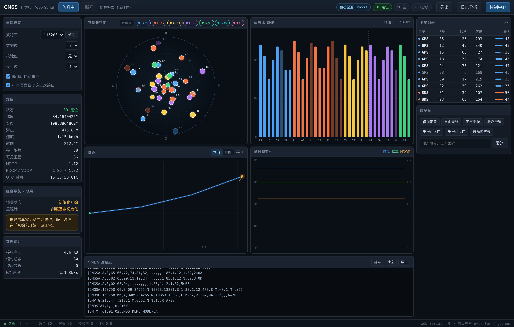
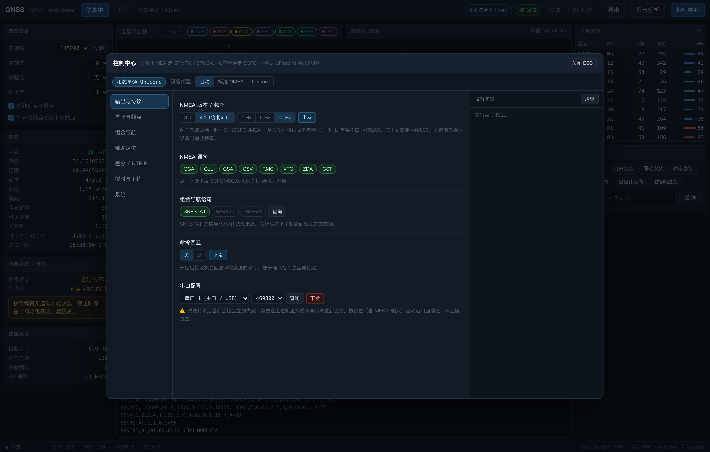
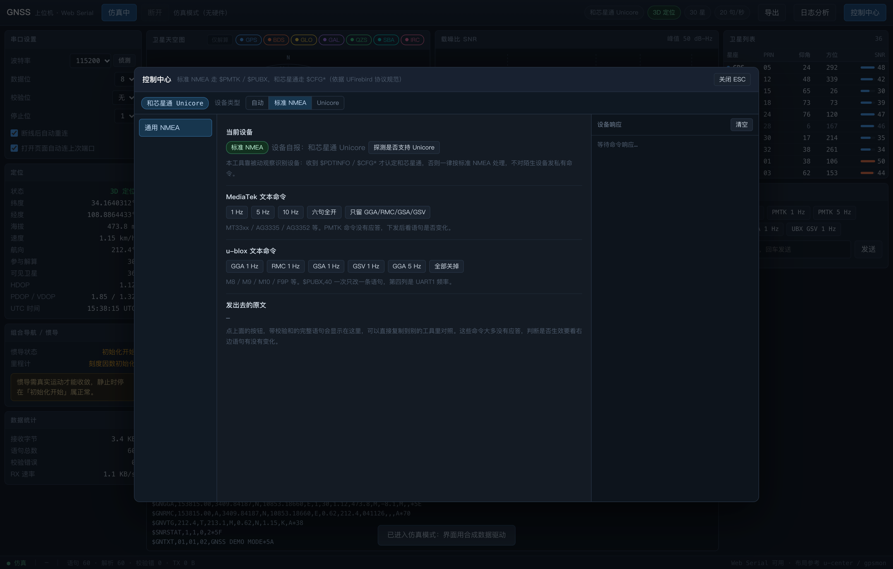
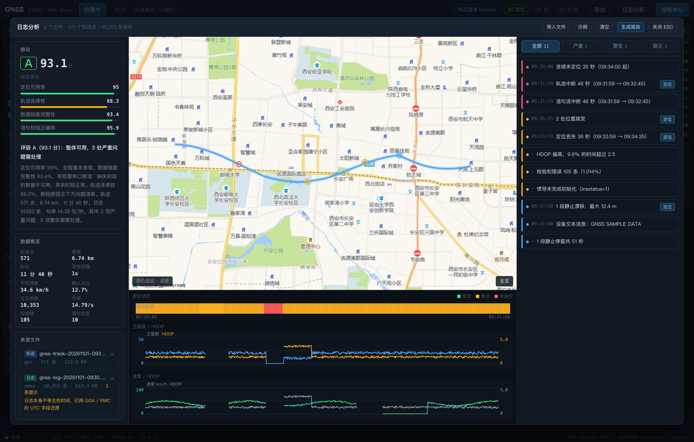

# GNSS 上位机（Web Serial）

浏览器直接读串口，不用装软件、不用装驱动。天空图、载噪比、轨迹、时序、原始流、导出，
再加一个能把 NMEA 日志读回来做诊断的报告引擎，全在一个页面里。



做这个工具的起点是两个具体问题：换一块板子就要重装一套调试软件；日志导出之后没人读得回来。
前者用浏览器解决，后者用了一个反向读日志的诊断引擎。

---

## 它和 u-center / gpsmon / RTKLIB 的区别

这三款都是成熟工具，功能比本工具全。本工具只押三件事：

| | u-center | gpsmon | RTKLIB | 本工具 |
|---|---|---|---|---|
| 安装 | Windows 客户端 | 终端程序 | 桌面三件套 | 浏览器打开，零安装 |
| 设备范围 | u-blox | 通用 NMEA | 通用 / RINEX | 通用 NMEA + 和芯星通私有协议 |
| 强项 | UBX 全功能 | 逐句解码 | 后处理定位 | 轨迹与日志的时间轴对齐诊断 |
| 弱项 | 只认自家芯片 | 无图形 | 上手成本高 | 不做解算，不做 UBX 二进制 |

取舍很明确：它不是 u-center 的替代品，是「路测回来之后，把轨迹断档的原因说清楚」这件事的工具。
真要调 u-blox 的 UBX 参数，还是去用 u-center。

---

## 功能

| 模块 | 说明 |
|---|---|
| 串口连接 | 4800~921600，数据位/校验位/停止位可选；断线自动重连；**波特率自动侦测**（9 档依次试听，校验和连续通过两条才认定）；记住上次参数 |
| 卫星天空图 | 极坐标北朝上，30°/60° 仰角圈；星座着色，点大小随载噪比，参与解算加白边；点图例可筛选，筛选同步作用于 SNR 图与卫星表 |
| 载噪比柱图 | 按星座分组，实心=参与解算，半透明=仅可见 |
| 轨迹 | 本地等距投影（带比例尺、航向箭头）或高德底图；WGS84→GCJ-02 自动纠偏；跟随 / 全览 / 卫星影像 |
| 时序图 | 可见星数 / 解算星数 / HDOP 三条曲线，双 Y 轴 |
| 定位面板 | 定位类型、经纬高、速度航向、DOP、UTC、参与解算与可见星数 |
| 控制中心 | 标准 NMEA 走 `$PMTK` / `$PUBX,40`；和芯星通走 `$CFG*`，七个页签。见「设备兼容」 |
| 命令台 | 常用命令一键下发，也可手输任意语句 |
| 导出 | 轨迹 4 种 + 日志 3 种，可只导其一，时间范围可选 |
| 日志分析 | 读回导出文件，把轨迹缺口与日志时间轴对齐，判定是链路掉线、定位丢失、静止停留还是记录丢失，出可编辑的 HTML 报告 |

快捷键：`⌘S` 导出、`⌘K` 聚焦命令输入、`Esc` 关闭弹层。
深链：`?demo=1` 仿真、`?track=map` 地图、`?ctl=1&tab=ins` 控制中心、`?an=sample` 日志分析示例。

---

## 快速开始

```bash
git clone https://github.com/z75993971/gnss-web-host.git
cd gnss-web-host
bash start.sh            # 起本地服务并打开浏览器
bash start.sh demo       # 没有硬件时用仿真数据看界面
bash stop.sh             # 停服务
```

浏览器只支持 **Chromium 内核**（Edge / Chrome）。Safari 与 Firefox 没有实现 Web Serial，
这是能力缺失，不是兼容性问题。

连上后点右上角「连接串口」，选你的接收机。不确定波特率就点左侧「侦测」：
它按 115200 → 9600 → 38400 → 57600 → 230400 → 460800 → 921600 → 19200 → 4800 依次试听，
最多 8 秒。判据是「连续两条语句校验和通过」——速率错了读到的是乱码，几乎不可能蒙对。

> **串口是独占的。** Web 版、Python 版、u-center、串口助手，同一时刻只能有一个占着。

---

## 设备兼容

主干功能（天空图、载噪比、轨迹、时序、导出、日志分析）只依赖 NMEA-0183，
**任何吐 NMEA 的接收机都能用**：u-blox、和芯星通、移远、中科微、泰斗、Trimble、Quectel 都行。
RMC / GGA / GSA / GSV / VTG / GST / ZDA 全部解析，多星座 GSA 按系统 ID 分开记录。

配置能力分两档，这是硬事实，不是偷懒：

| 设备 | 能做的事 | 依据 |
|---|---|---|
| **标准 NMEA**（默认） | 只读监视 + 通用文本命令：MediaTek `$PMTK`、u-blox `$PUBX,40` | NMEA-0183 本身没有下行配置通道，改语句开关必须用厂商命令 |
| **和芯星通 Unicore** | 输出协议、星座频点、组合导航、辅助定位、授时、复位、配置存盘 | `$CFG*` / `$PDTINFO`，按 UFirebird 协议规范原文实现 |

识别靠被动观察：收到 `$PDTINFO` 或 `$CFG*` 才认定 Unicore，否则一律按标准 NMEA 处理，
**不会对陌生设备发私有命令**。也可以在控制中心顶部手动锁定模式——选错模式只影响发哪套命令，
不改设备状态。

**不支持 u-blox UBX 二进制协议。** `$PUBX,40` 只能改语句频率；`UBX-CFG-VALSET`、`UBX-NAV-PVT`
这类需要独立的二进制帧收发通道，本版本没做。与其给个半残的实现，不如写清楚边界。

| 和芯星通模式（七个页签） | 标准 NMEA 模式（通用命令页） |
|---|---|
|  |  |

---

## 日志分析：真正的差异点

导出是条单行道——文件生成出来了，但没人读得回来。跑完一轮路测，轨迹中间缺一截，
光看轨迹只能猜是「线掉了」还是「天线被挡了」。

把轨迹和日志一起读回来，缺口就能定性。四类归因：

| 归因 | 日志同一时段的表现 | 真正的原因 |
|---|---|---|
| `link` 链路中断 | 日志也断了 | USB 松、供电不足、串口被抢、设备重启、后台标签页被节流 |
| `lost` 定位丢失 | 有 GGA 但 quality=0 占 80%+ | 天线被挡、多路径、冷启动前 30~60 秒 |
| `static` 静止停留 | 定位正常且位移很小 | **不是故障**。相同坐标不重复入轨迹，停着本来就不产生新点 |
| `unrecorded` 记录丢失 | 定位正常但位移明显 | 缓冲滚动覆盖，或导出时选了较短时间范围 |

评分四维加权（定位可用率 45% / 轨迹连续性 25% / 链路完整性 20% / 校验正确率 10%），
A ≥ 92、B ≥ 80、C ≥ 65。报告出 HTML / Markdown / 问题 CSV 三种，
HTML 版整页可编辑、可直接打印成 PDF。

规则细节、阈值、以及「为什么静止不能当故障」这类踩坑记录见
[docs/analysis-engine.md](docs/analysis-engine.md)。



没有现成数据也能试：

```bash
python3 tools/make_samples.py   # 生成 samples/ 下的示例轨迹与日志
```

`samples/` 里那两个文件是同一次「故意搞坏」的会话：571 个轨迹点、10,353 条语句，
埋了链路中断、定位丢失、跳点、校验错误、静止停留、绕圈漂移六类状况。
两个都导入 → **A 级 93.1 分 / 11 条问题**（严重 3、警告 5、提示 3）；
只导轨迹 → B 级 88.3 分 / 5 条。对比着看，就明白日志为什么必须一起导。

---

## 导出

| 轨迹 | 说明 | 日志 | 说明 |
|---|---|---|---|
| GPX | 兼容性最好，Google Earth / 奥维 / QGIS / GPSBabel 都认 | NMEA 原文 | 可回放给 u-center、RTKLIB、GNSS Viewer |
| KML | Google Earth 原生，用 `LineString` 不用 `gx:Track` | 带时间戳文本 | 每行前加主机 ISO 时间，排查时序问题靠它 |
| GeoJSON | GIS 与前端地图通用，properties 里带里程与坐标基准 | JSONL | 一行一个 JSON，便于脚本过滤 |
| CSV | 10 列，Excel / pandas 直接算 | | |

三条容易踩的：

1. **导出的坐标一律 WGS84 原始值。** 地图视图里做了 GCJ-02 纠偏，文件里绝不做——转了之后
   导入 Google Earth、奥维、QGIS 会整体偏几百米。
2. **GeoJSON 坐标顺序是 `[经度, 纬度, 高度]`**，和 GPX 的 `lat`/`lon` 属性相反。
3. **显示缓冲和导出缓冲是分开的。** 面板只留 600 条用于显示，导出走 20 万条的独立缓冲。
   按「暂停」只冻结面板，日志照常记录。

---

## 地图（可选）

不配 Key 也能用：轨迹画在本地平面图上（等距投影 + 网格 + 比例尺），能看形状和问题点位置，
只是没有道路参照。

想要真实底图，去[高德开放平台](https://console.amap.com/dev/key/app)建一个 Key：

| Key 类型 | 表现 |
|---|---|
| **Web端(JS API)** | 可拖动缩放、卫星影像、跟随 |
| **Web服务** | 静态底图兜底，由本地 `server.py` 代理取图，**Key 不出现在前端** |

放进 `map-key.local.js`（已 gitignore）或页面「Key」弹层：

```js
window.__GNSS_MAP_JS_KEY__  = '';   // Web端(JS API)
window.__GNSS_MAP_WEB_KEY__ = '';   // Web服务
window.__GNSS_MAP_SEC__     = '';   // JS API 安全密钥 jscode
```

**本项目不内置任何可用密钥。** 地图 Key 是账号资产，写死在前端等于公开。

---

## 差分 / NTRIP

控制中心「差分 / NTRIP」页签内置 NTRIP 客户端，支持千寻 FindCM 等标准 caster。
NTRIP 是带 `Authorization` 头的 HTTP 流，浏览器直连会被 CORS 预检拦掉，
所以 TCP 连接放在 `server.py` 里，页面只跟 `127.0.0.1` 通信。

没有账号也能验证链路：

```bash
python3 tools/mock_caster.py 2101     # 假 caster：会鉴权、推 RTCM3 帧、打印收到的 GGA
# 页面填 127.0.0.1 / 2101 / AUTO / testuser / testpass
```

边界一句话说清：**本工具只负责把差分数据送进串口，能不能到厘米级取决于接收机。**

---

## 测试

```bash
node selftest.mjs          # 260 项断言，纯逻辑，不需要浏览器
```

覆盖：校验和、经纬度解析、GSA 分系统记录、GSV 整轮替换、跨系统同号卫星、私有帧、
异常输入、GCJ-02 正反解、`CFGSYS` 位掩码、命令校验和、`AIDTIME`/`AIDPOS` 度分格式、
`AIDINFO` 位图、SBAS 星座拆分、七种导出格式、导出→读回闭环、格式嗅探与坏行容错、
缺口四类归因、跳点合并、静止漂移、评分与报告。

实机应答回归（验证回读不丢值）：浏览器直接打开 `test-readback.html`。

端到端（需 `pip install playwright`）：

```bash
python3 tools/e2e_analysis.py   # 载入示例 → 核对诊断条数与评级 → 地图底图 → 报告下载
```

---

## 已知边界

- **不做 RTK 解算。** 只显示接收机报出来的定位质量。GGA quality 只认到 `2 伪距差分`——
  NMEA 标准里有 `4 固定解` / `5 浮动解`，但很多模块根本不输出这两个值。
- **不做 u-blox UBX 二进制协议。** 见上文。
- **不做数据修复。** 诊断只给判定和处置建议，不自动剔除跳点、不平滑漂移。
  动不动原始数据，得由看报告的人决定。
- **日志与轨迹必须同一时段。** 两次记录时间不重叠时，缺口一律归 `unknown`，不瞎猜。
- **只支持 Chromium 内核浏览器。** Safari / Firefox 没有 Web Serial。

---

## Roadmap

- [ ] u-blox UBX：`NAV-PVT` / `NAV-SAT` / `MON-VER` 解析，`CFG-VALSET` 收发（需要真机验证）
- [ ] 多会话对比：两次路测的可用率、跳点、链路稳定性并排看
- [ ] RTCM3 差分数据透传日志与回放
- [ ] 移动端采集（已有鸿蒙 ArkTS 版本原型，暂未并入本仓库）

---

## 目录

```
index.html      页面结构
style.css       深色仪表盘样式
app.js          Web Serial + UI + Canvas 绘图 + 串口写队列
nmea.js         NMEA-0183 解析核心（纯逻辑，可单测）
vendor.js       厂商适配层：被动识别 + 通用命令表
controls.js     控制中心（标准 NMEA / Unicore 两套页签）
map.js          高德地图：JS API 版 + 静态底图版，WGS84↔GCJ-02
ntrip.js        NTRIP 客户端 + RTCM 消息类型表
export.js       导出：GPX / KML / GeoJSON / CSV / 日志三态
import.js       反向解析：七种格式，格式嗅探 + 坏行容错
analyze.js      诊断引擎：缺口归因 → 问题翻译 → 评分
report.js       报告：HTML / Markdown / 问题 CSV
analysis.js     日志分析面板
config.js       Key 与界面偏好
server.py       本地服务：静态托管 + 静态地图代理 + NTRIP 客户端
selftest.mjs    单测（260 项）
docs/           截图与设计文档
tools/          假 caster、示例数据生成、端到端验证
```

实现细节另见 [docs/analysis-engine.md](docs/analysis-engine.md)（诊断引擎）与
[docs/unicore.md](docs/unicore.md)（和芯星通协议与实测记录）。

---

## 实测记录

在**和芯星通 UM621A-02**（UC6580A，固件 R6.0.0.0Build4963）上跑过完整验证：
3D 定位、46 颗可见 / 28 颗解算、HDOP 1.29；控制中心回读 `$CFGPRT,1,0,460800,H481,HA3`、
`$CFGSYS,H155155`、`$CFGINS,2,1,1,1`，与界面出厂默认值并不一致——这也是
「先回读再下发」这条铁律的由来。细节见 [docs/unicore.md](docs/unicore.md)。

---

## License

[MIT](LICENSE)
