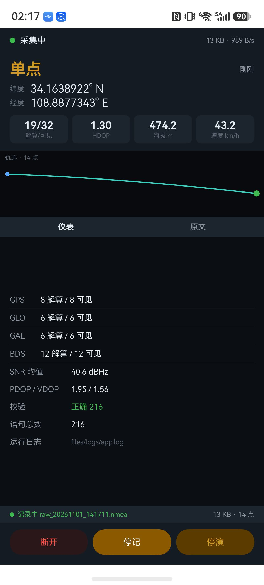
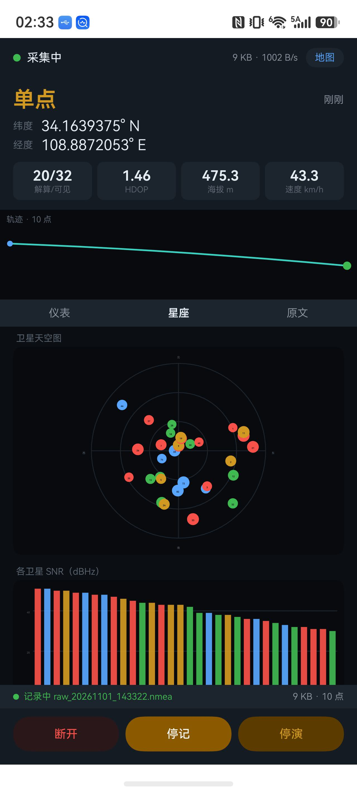

# 鸿蒙手机采集器（ArkTS）

手机直连模块板：手机供电、手机记录，全程不需要电脑。插上就能采，
采完把 `raw_*.nmea` 拖进仓库根目录的 Web 版分析面板出诊断报告。

**状态**：解析、界面、轨迹、落盘、日志、地图全链路已在真机跑通（HarmonyOS 7.0 / API 26）。
**未验证**：真实 USB 串口读取——等模块板插到手机 USB-C 口才能确认。

| 截图 | 截图 |
|---|---|
|  |  |

---

## 一、已跑通的功能

用内置演示模式（150 秒真实西安轨迹样本，2401 条语句）实测：

| 功能 | 结果 |
|---|---|
| NMEA 解析（GGA/RMC/GSA/GSV） | 坐标、海拔 474.2 m、速度 43.2 km/h 全对 |
| 星座分类 | GPS 8/8 · GLO 6/6 · GAL 6/6 · BDS 12/12 |
| 多星座 GSA 分星座统计 | 19/32 解算/可见 |
| PDOP/VDOP/HDOP | 1.95 / 1.56 / 1.30 |
| 校验和统计 | 216 条全对 |
| 轨迹绘制 | Canvas 画线 + 起终点标记 |
| 原始报文落盘 | `raw_*.nmea`，13 KB |
| 轨迹 CSV 落盘 | `track_*.csv`，字段完整 |
| 运行日志落盘 | `app.log`，中文正常 |
| 界面实时刷新 | 200 ms 一次 |
| 卫星天空图 + SNR 柱图 | 20+ 颗星，颜色区分星座 |
| 高德地图实时位置 | 深色底图，位置准确 |

---

## 二、编译与安装

### 先配好自己的签名

仓库里的 `build-profile.json5` **不包含任何签名配置**（`signingConfigs` 是空数组）。
用 DevEco Studio 打开工程，按 `File → Project Structure → Signing Configs`
勾选自动签名，它会生成属于你自己账号的证书与 profile。

不做这一步编不出可安装的 HAP，报 `signingConfig not found`。

### 命令行编译

```bash
bash tools/build.sh          # debug
bash tools/build.sh release
```

脚本做三件事，每一件都对应一个实测踩过的坑：

1. 把源码同步到 `~/harmony-build/UM621Collector`（纯英文路径，见踩坑 1）
2. 设置工具链环境变量，清掉 `NODE_OPTIONS` / `NODE_PATH` 污染（见踩坑 2）
3. 调 `hvigorw assembleHap`，只把关键行打出来，产物拷到 `产物/`

### 装到手机

```bash
HDC="/Applications/DevEco-Studio.app/Contents/sdk/default/openharmony/toolchains/hdc"
"$HDC" list targets                                  # 拿设备序列号
"$HDC" -t <设备序列号> install -r 产物/entry-default-signed.hap
"$HDC" -t <设备序列号> shell aa start -a EntryAbility -b com.zhangrui.um621collector
```

手机锁屏时 `aa start` 会报 `screen is locked`，先解锁。

### 演示模式

打开 App → 底部点「演示」。内置 150 秒真实轨迹按 16 行/秒循环播放，
走的是和真实串口完全相同的处理链，用来验证解析、界面、落盘是否正常。

### 拉日志和记录文件

```bash
DIR="/data/app/el2/100/base/com.zhangrui.um621collector/haps/entry/files/logs"
"$HDC" -t <设备序列号> file recv "$DIR" ~/Desktop/um621_logs
```

里面有：

- `app.log` —— 运行日志（启动、USB 枚举、错误）
- `raw_*.nmea` —— 原始报文，纯 NMEA 行，**可直接拖进 `../` 的日志分析面板**
- `track_*.csv` —— 轨迹点，一行一个

---

## 三、踩坑记录（都是实测撞出来的）

### 1. 鸿蒙工具链不认中文和空格路径

```
00306003 Specification Limit Violation
Invalid project path. Current path does not match: ...
```

源码放中文工作区方便看，编译前 rsync 到纯英文目录再编。`tools/build.sh` 就是干这个的。

### 2. 注入的 NODE_OPTIONS 会污染 hvigor

现象：编译刷一屏 `EPIPE` / `ERR_STREAM_DESTROYED`，指向某个 `broker-ipc-client.cjs`。
解法：脚本里 `unset NODE_OPTIONS` 和 `unset NODE_PATH`。

### 3. @Builder 按值传参不响应状态变化

四个指标抽成 `@Builder metric(value, label)` 后**永远显示初始化那一帧**的 `0/0` 和 `-1.00`，
实时值进不来；坐标因为直接写在 `build()` 里反而正常。

ArkUI 的既定行为：@Builder 按值传参不触发刷新（要按引用传）。
解法：四个指标内联展开，不抽 @Builder。

**教训**：数据明明对、界面不更新 → 先怀疑 @Builder / 状态没绑对，别怀疑解析。

### 4. 日志中文乱码

`String.charCodeAt(i) & 0xFF` 只适合 ASCII，中文是 UTF-8 多字节，会被打碎成乱码。
必须用 `util.TextEncoder.encodeInto()`。

### 5. `Circle().fill()` 是 API 26 才有的

工程 `compatibleSdkVersion` 是 5.0.0(12)，用 `Circle().fill()` 在老设备上崩。
解法：用 `Row().borderRadius(n).backgroundColor()` 画圆点。

### 6. 空值别用 -1 当哨兵

`FixSnapshot` 用 `-1` 表示"没有值"，界面直接显示 `-1.00`。改成 `NaN`，
`numText()` 判 `isNaN` 统一显示 `—`。

---

## 四、代码结构

```
UM621Collector/entry/src/main/ets/
├── entryability/EntryAbility.ets   应用入口
├── pages/Index.ets                 主界面（状态卡 + 轨迹 + 报文 + 记录 + 演示）
├── pages/MapPage.ets               地图页（WebView + 高德 JS API）
├── usb/SerialPort.ets              USB 驱动（CDC-ACM + 设备诊断 + 全流程埋点）
├── nmea/NmeaParser.ets             NMEA 解析
├── store/LogStore.ets              双文件落盘
└── util/
    ├── DbgLog.ets                  运行日志（UTF-8，写手机沙箱）
    └── DemoSource.ets              演示数据源（读 rawfile/demo.nmea）

entry/src/main/resources/rawfile/
├── demo.nmea                       150 秒真实轨迹样本（2401 条，145 KB）
└── map.html                        高德地图页面（WGS84→GCJ-02 在显示层做）
```

**USB 驱动优先走 CDC-ACM**。CH343 在 CDC 模式下列举为标准 USB 通信类，
用标准类请求（`0x21/0x20` 设波特率、`0x21/0x22` 拉 DTR/RTS）就能工作，不用手写厂商寄存器。
如果设备枚举成厂商自定义类（VCP 模式），App 会明确报错而不是静默失败，
并在 `app.log` 里 dump 出所有接口和端点信息。

**原始日志存纯 NMEA 行，不加前缀**，所以能直接拖进 Web 版分析面板跑诊断报告。
这是刻意对齐的：手机上只管采，分析在电脑上做。

---

## 五、高德地图

App 里点顶栏「地图」进入，走 **WebView + 高德 JS API**，不是鸿蒙原生 SDK。

**为什么不用原生 SDK**：原生地图要「HarmonyOS 平台」类型 Key 并绑定 AppID，申请链路长；
还要装 ohpm 依赖，和 API 26 有适配风险。这里只需要 1 Hz 位置更新 + 画轨迹，WebView 够用。

### 配置 Key

**必须申请「Web端(JS API)」类型的 Key。** 「Web服务」类型的地图加载不出来
（那是给服务端拉静态图用的）。安全密钥（jscode）实测不是必须的，留空能正常加载。

```bash
bash tools/set-map-key.sh "你的Key" ""
bash tools/build.sh
```

**本仓库不内置任何 Key。** `map.html` 里是 `__AMAP_KEY__` 占位符，没配时地图页会直接
提示「还没配置高德 Key」，不会白屏。

### 三个坑

**① 坐标必须转 GCJ-02**
GNSS 输出 WGS84，高德底图是 GCJ-02，不转会整体偏几百米。转换在 `map.html` 的
`wgs84ToGcj02()` 里做，**只在显示时转**——落盘的 `raw_*.nmea` 和 `track_*.csv` 仍是
WGS84 原始值，否则导入 QGIS 会偏。

**② 鸿蒙 WebView 的 UA 会被高德判成老浏览器**
不处理会降级到兼容模式，`mapStyle: 'amap://styles/dark'` 直接失效（底图变浅色）。
解法：`MapPage.ets` 的 Web 组件上伪造 UA。

**③ `Polyline` 的 path 不能给空数组**
报 `error Polyline path`。构造时不给 `path` 字段，等有数据再 `setPath()`。

### 轨迹样式

- 连接线用虚线，给圆圈让位
- 轨迹点按 **12 米间隔抽样**而不是按点数——1 Hz 采集时慢速点密得连成团、快速又稀疏，按距离抽才均匀
- 用 `AMap.MassMarks` 而不是一堆 `CircleMarker`，上千个后者会把地图拖卡

---

## 六、下一步

1. **插模块板验证真实 USB 读取**（最后一关）：手机 OTG 供电，App 里点「连接」，
   看有没有出现 `CDC/CH34x` 和 VID `1A86:55D3`，`app.log` 里有没有「模式 CDC」
2. 后台长时任务（现在靠屏幕常亮顶着，锁屏会断）
3. 日志导出到手机公共目录（现在要用 hdc 拉）
